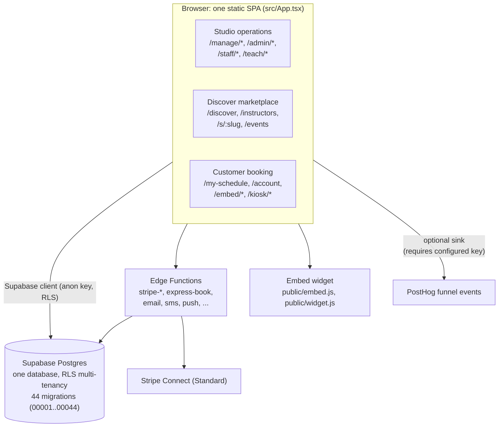

# Tandava

**Open-source studio management software: run it yourself, or let us host it.**

Scheduling. Memberships. Payments. Check-in. Analytics. Built for yoga, pilates, and movement studios.

Two ways to use Tandava:

- **Hosted:** sign up at **[tandavastudio.com](https://tandavastudio.com)**, complete the setup wizard, and go live. No servers, no DNS, no deployment. Free to run: we make money only by taking a small percentage of the payments you process, so we only earn when your studio does.
- **Self-host:** clone this repo and deploy it on your own infrastructure. Own every byte, pay only your hosting costs, change anything. AGPL-3.0.

> **[Live Demo](https://tandava-flame.vercel.app):** explore the full platform with sample data. No signup required.

*Tandava* is the cosmic dance in Hindu tradition, representing the rhythm of creation, preservation, and transformation. We chose this name because running a studio should feel like a practice: purposeful, flowing, and yours to shape.

Last verified: 2026-10-20 (against repo HEAD `d694b2ba6`).

---

## What This Is

Tandava is studio management software you can either **sign up for** (hosted) or **deploy yourself** (open source); the same application either way.

It handles the operational reality of running a movement studio: scheduling classes, tracking memberships, processing payments, managing teachers, and understanding your business through analytics.

It is designed for studios with 1-3 locations where the owner is often also the lead teacher, the person handling check-ins, and the one reconciling the books at month-end.

**Open core, not open bait.** Every feature is in this repository. Nothing is held back for a paid tier. The hosted version runs this exact code; you pay for the convenience of not operating it, not for locked features. The software is licensed AGPL-3.0, which keeps it open for everyone and lets the project sustain itself by offering hosting.

**What you get:**
- Full scheduling with recurring classes, subs, and cancellations
- Membership and class pack management with purchase and consumption tracking
- Student profiles with visit history and waiver tracking
- Teacher profiles with pay rates, availability, and performance analytics
- Check-in system with kiosk mode and QR codes
- Analytics dashboards for attendance, revenue, and retention
- Event and workshop management with historical trends
- Data import from MindBody, Momence, Walla, and others

**What you don't get:**
- Vendor lock-in
- Per-member pricing that scales against you
- Data you can't export
- Features hidden behind enterprise tiers

## Which Path Is Yours

**Non-technical owner? Use the hosted version.** Go to [tandavastudio.com](https://tandavastudio.com), sign up, and the setup wizard walks you through your studio, staff, offerings, pricing, waivers, importing data from your old system, and connecting Stripe. You never touch a server, a database, or DNS. This is the turnkey path.

**Have a developer, or want full control? Self-host.** Clone the repo and deploy it on your own Supabase + static host. You own the data and the infrastructure, and you can change anything. This requires comfort with hosting, environment variables, and payment configuration (see [DEPLOYMENT.md](DEPLOYMENT.md)).

### Honest status

The frontend and workflows are complete; the backend (Supabase schema, auth, RLS, edge functions) is architecturally ready and being hardened under real use. If you self-host today, budget time to verify RLS, payments, and email against your own project before real members rely on it. The hosted version exists precisely so you don't have to.

**Tandava is multi-tenant by design.** One deployment serves many studios, isolated by row-level security, which is exactly what makes the hosted version possible. Self-hosters typically run it for a single studio (or a few locations under one owner), but the platform capabilities are real, not scaffolding.

---

## Three Surfaces, One App

Tandava is **one static SPA** (`src/App.tsx` hosts a single `BrowserRouter`), backed by **one Supabase Postgres database** with row-level-security multi-tenancy. It is not three apps and not a monorepo: there is one `package.json`, 44 migrations in `supabase/migrations/`, and 15 edge functions plus `_shared` in `supabase/functions/`. No inter-app sync exists because there is nothing to sync.

The "three apps" you will see described elsewhere are **three route groups** serving three audiences:

| Surface | Who it serves | Routes (verified in `src/App.tsx`) | Key pages |
|---|---|---|---|
| **Studio operations** | Owners, admins, front desk, teachers | `/manage/*`, `/admin/*`, `/staff/*`, `/teach/*` | `src/pages/manage/` (schedule, students, teachers, offerings, financials, reports, import, settings, events, analytics hub, automations, campaigns, and more), `src/pages/admin/*`, `StaffCheckin`, `StaffWaitlist` (`/staff/checkin`, `/staff/waitlist`), `src/pages/teach/*` (dashboard, schedule, availability, subs, earnings, profile). Guarded by permissions like `studio.manage_schedule`, `studio.manage_settings`, `platform.admin`, `studio.checkin`, `studio.teach`. |
| **Discover marketplace** | Prospective students | `/discover`, `/instructors`, `/instructors/:id`, `/events`, `/events/:id`, `/s/:slug`, `/on-demand`, `/schedule` | `Discover.tsx`, `Instructors.tsx`, `InstructorDetail.tsx`, `StudioStorefront.tsx` (`/s/:slug`), `OnDemand.tsx`, `Schedule.tsx`. The signed-out home page is `/` in `platform` mode or the Discover experience in `discover` mode (`VITE_HOME_MODE`). The `discover_classes` RPC (migration `00025`) powers class search. |
| **Customer booking** | Members | `/my-schedule`, `/account`, `/account/notifications`, `/community`, `/home`, `/s/:slug/book/:occurrenceId`, `/s/:slug/save-details`, `/embed/schedule/:slug`, `/embed/event/:id`, `/kiosk/:studioId` | `MySchedule.tsx`, `Account.tsx`, `src/pages/account/*`, `ExpressBooking.tsx` (login-free guest booking, PRD-020), `SaveDetails.tsx`, `Kiosk.tsx`, `src/pages/embed/*` (`EmbedSchedule`, `EmbedEvent`, `EmbedLayout`). |

Studios also reach customers outside the app: the embeddable booking widget (`public/embed.js`, `public/widget.js`, the `<tandava-schedule>` element; see `docs/guides/website-embed.md`), per-studio subdomains via `VITE_ROOT_DOMAIN` (e.g. `oxatl.tandavastudio.com`), and storefront deep links (`/s/<slug>`, `/s/<slug>/book/<occurrenceId>`) that will become the native apps' universal links.

### Native apps (separate implementation review)

Two store apps are planned, following the "two apps, one backend" model: **Tandava** for members (`com.tandava.app`) and **Tandava Studio** for owners and staff (`com.tandava.studio`). The base branch documents the Oct 8 plan; native implementation is being reviewed separately in PR #102. No native project is included in this documentation PR. Consult that PR and `docs/app-store/STORE-APPS.md` for current build and release evidence. The recommended shell is Capacitor, the same approach used by the sibling Purafield apps.



---

## Live Demo

Explore the full platform at **[tandava-flame.vercel.app](https://tandava-flame.vercel.app)**.

The demo loads a complete fictional studio (Oxatl Yoga, Austin TX) with 3 locations, 18 teachers, and 500 members. Switch between roles using the bar at the top:

| Role | What You See |
|------|-------------|
| Studio Owner | Dashboard, schedule management, financials, teacher analytics, events |
| Instructor | Teaching dashboard, check-in students, earnings, sub requests |
| Front Desk | Class check-in, waitlist management |
| Member | Browse classes, book, view schedule, track progress |

No signup, no backend, no database. Everything runs client-side with mock data (set `VITE_DEMO_MODE=true`; demo fixtures live in `src/data/demo/`; some public routes also contain inline sample data, so disabling demo mode alone does not remove every sample-data surface).

---

## Quick Start

**Just want to run a studio?** Skip all of this. Go to [tandavastudio.com](https://tandavastudio.com), sign up, and follow the setup wizard. See the [studio owner quickstart](docs/studio-manager/getting-started.md).

**Want to run the code locally or self-host?**

```bash
# Clone and install
git clone https://github.com/TaylorONeal/tandava.git
cd tandava
npm install

# Run in demo mode (no backend needed)
echo "VITE_DEMO_MODE=true" > .env.local
npm run dev
```

Opens at `http://localhost:8080` with sample data.

- **Self-host for your own studio:** [DEPLOYMENT.md](DEPLOYMENT.md)
- **Operate the hosted service (run your own tandavastudio.com):** [docs/OPERATOR_SETUP.md](docs/OPERATOR_SETUP.md)
- **Local backend setup (Supabase, env vars):** [docs/developer/setup.md](docs/developer/setup.md)

---

## Tech Stack

| Layer | Technology |
|-------|------------|
| Frontend | React 18 + TypeScript + Vite 7 |
| UI | shadcn/ui (Radix) + Tailwind CSS 3 |
| Routing | react-router-dom ^7.18.3 (`src/App.tsx`, one `BrowserRouter`) |
| Data fetching | TanStack Query |
| Backend | Supabase (PostgreSQL + Auth + Storage + Edge Functions) |
| Payments | Stripe Connect (Standard) |
| Hosting | Any static host (Vercel, Netlify, Cloudflare Pages, self-hosted) |
| Analytics | PostHog funnel events via plain fetch, no SDK (optional; deployment configuration not verified here); Sentry (optional) |

No Node.js server runtime needed in production. The frontend is a static SPA (`vercel.json`); all backend logic runs in Supabase (PostgreSQL + Edge Functions). Application code imports from `src/lib/backend/` (a provider interface), never from Supabase directly, so the backend is swappable in principle.

---

## Environment Variables

Copy `.env.example` to `.env`. The important ones (all verified in `.env.example`):

| Variable | Purpose |
|---|---|
| `VITE_DEMO_MODE` | `true` runs the app on mock data, no backend needed |
| `VITE_SUPABASE_URL`, `VITE_SUPABASE_ANON_KEY` | Supabase project (production) |
| `VITE_HOME_MODE` | `platform` (default) or `discover`; controls what signed-out visitors see at `/` |
| `VITE_ROOT_DOMAIN` | Enables per-studio subdomains (e.g. `oxatl.tandavastudio.com`); leave blank to disable |
| `VITE_STRIPE_PUBLISHABLE_KEY` | Stripe publishable key (frontend) |
| `VITE_POSTHOG_KEY` | Turns on the funnel event sink; empty means events are dropped (deliberate). `VITE_POSTHOG_HOST` optional (defaults to `https://us.i.posthog.com`) |
| `VITE_SENTRY_DSN` | Optional error monitoring |
| `VITE_TURNSTILE_SITE_KEY` | Cloudflare Turnstile for sign-up/sign-in forms (deploy with this set before enabling captcha in Supabase) |
| `VITE_VAPID_PUBLIC_KEY` | Web push public key (frontend half) |
| `VITE_APP_URL`, `VITE_APP_NAME` | App URL and display name |

Server-side secrets (Supabase secrets, never in the frontend): `STRIPE_SECRET_KEY`, `STRIPE_WEBHOOK_SECRET`, `STRIPE_CONNECT_MODE`, `STRIPE_CONNECT_WEBHOOK_SECRET`, `PLATFORM_FEE_BPS`, `APP_URL`, `EMAIL_PROVIDER` (+ `RESEND_API_KEY` / `SENDGRID_API_KEY` / SMTP settings), `SMS_PROVIDER` (+ Twilio keys), `VAPID_PRIVATE_KEY`, `ANALYTICS_IP_SALT` (salt for the analytics-session edge function's per-source rate limit).

## Scripts

All scripts verified in `package.json`:

| Script | What it does |
|---|---|
| `npm run dev` | Vite dev server |
| `npm run build` | Production build (`prebuild` runs locale checks; `postbuild` runs post-build steps) |
| `npm run typecheck` | `tsc --noEmit` on the app |
| `npm run lint` | ESLint |
| `npm run test` | Vitest suite plus `test:scripts` (Node tests for `scripts/`) |
| `npm run test:db` | Database migration tests (`bash scripts/db-test.sh`) |
| `npm run check:edge` | Deno typecheck of the edge functions |
| `npm run test:e2e` | Playwright end-to-end tests (`e2e/`) |
| `npm run smoke:stripe` | Stripe smoke test (`scripts/smoke/stripe-smoke.mjs`) |
| `npm run test:editorial`, `npm run typecheck:editorial` | Blog/editorial content pipeline checks (`editorial/`) |

## Testing and CI

`.github/workflows/` has three workflows: `ci.yml` (typecheck, lint, vitest, build, DB migration tests on postgres:16, Deno edge typecheck), `platform-independence.yml` (runs `scripts/check-platform-independence.sh`, which greps for unsupported platform dependencies on every push/PR), and `stripe-smoke.yml` (Stripe smoke test). Agent working rules live in `CLAUDE.md` and `docs/ai-agents/AGENTS.md` (read-before-write, extend don't duplicate, commit format `<type>: <desc>` plus a claude.ai session link).

---

## Current Status

Tandava is in active development. The demo shows complete UI and workflows. Some features require backend integration for production use.

**Working now (frontend complete):**
- Full UI for scheduling, bookings, roster management
- Role-based access enforced at the route level (Owner, Admin, Teacher, Front Desk, Student)
- Analytics dashboards with revenue, attendance, retention metrics
- Teacher check-in dialog with student roster
- Event management with historical trends
- Demo mode with realistic sample data
- CSV import engine: real parsing, provider auto-detection, column auto-mapping, validation, and dedupe (see `src/lib/connectors/`)
- Embeddable booking widget: a one-line `<script>` that puts your live schedule / a "Book Now" button / an event on your own website (Squarespace, Wix, WordPress); see `public/embed.js` and `/manage/embed`

**Backend implemented, needs your keys/config:**
- Payments: Stripe Checkout, Customer Portal, and webhook Edge Functions are implemented (drop-in, membership subscriptions, class packs) and support both single-studio and Stripe Connect platform modes; set your Stripe secrets and webhook endpoint to go live
- Email: provider abstraction (Resend / SendGrid / SMTP / console) with a deployable Edge Function. Set `EMAIL_PROVIDER` + keys
- Auth: real Supabase Auth (mock only when `VITE_DEMO_MODE=true`)
- Data persistence: full Supabase schema with RLS. Run the migrations

**Still in progress (see [docs/ROADMAP.md](docs/ROADMAP.md)):**
- Wiring the booking/checkout UI to the live payment + entitlement layer
- Final import persistence (member creation via a service-role function)
- SMS / push notification providers
- Workshop/event registration UI (multi-session, deposits, partial series)

### Versioning

Tandava follows [SemVer](https://semver.org/). We are pre-1.0 (`v0.x`).

**What that means:**
- The API and schema may change between minor versions
- Migration paths will be documented but not guaranteed to be automated
- Pin to a specific commit or tag when deploying to production
- Check the changelog before pulling updates

**Release strategy:**
- Releases are tagged in git (starting at `v0.1.0`)
- Each release includes a summary of changes and migration notes if applicable
- There is no npm package. This is meant to be forked and deployed, not installed as a dependency

---

## Features

### For Studio Owners

| Feature | Description |
|---------|-------------|
| Dashboard | Today's schedule, KPIs, alerts |
| Schedule Management | Recurring rules, substitutions, cancellations |
| Student Management | Profiles, memberships, visit history, waivers |
| Teacher Management | Profiles, pay rates, availability, performance analytics |
| Offerings | Class types with descriptions, levels, capacity |
| Events and Workshops | Multi-session support, tiered pricing, historical trends |
| Financials | Memberships, class packs, transactions |
| Reports | Attendance, revenue, teacher performance |
| Feature Toggles | Tips, reviews, and other optional features on/off |
| Website Embed | One-line script widget for booking on your own site |
| Data Import | CSV import with column mapping |
| Settings | Studio info, policies, branding |

### For Teachers

| Feature | Description |
|---------|-------------|
| Dashboard | Upcoming classes, check-in students, schedule overview |
| Sub Requests | Request and accept substitutions |
| Earnings | Track pay, tips (when enabled), commissions |
| Availability | Set weekly availability for scheduling |

### For Students

| Feature | Description |
|---------|-------------|
| Class Browsing | Filter by location, style, teacher, time, in-person/virtual |
| Booking | Class packs, memberships, drop-in, waitlist |
| My Schedule | Upcoming and past bookings |
| Progress | Classes attended, streak tracking |

---

## Architecture

```
tandava/
├── .claude/                # agent commands and configuration
├── .github/workflows/      # ci.yml, platform-independence.yml, stripe-smoke.yml
├── docs/                   # documentation (see index below)
│   ├── ai-agents/          # AGENTS.md, KEY_FILES.md, LESSONS_LEARNED.md, DESIGN_SYSTEM.md
│   ├── app-store/          # STORE-APPS.md (planned native apps)
│   ├── architecture/       # domain model, RBAC, multi-tenancy, reliability, compliance
│   ├── developer/          # 01-domain-model .. 07-launch-architecture + setup guides
│   ├── prd/                # PRD-001 .. PRD-027, ATTRIBUTION_TRACKING.md, platform-overview
│   ├── data/               # CLASS_TYPES_TAXONOMY.md
│   └── guides/             # website-embed.md and other how-tos
├── e2e/                    # Playwright end-to-end tests
├── editorial/              # blog/editorial content pipeline
├── public/                 # static assets; embed.js, widget.js
├── scripts/                # check-locales.mjs, run-postbuild.mjs, db-test.sh,
│                           # check-platform-independence.sh, smoke/
├── src/
│   ├── App.tsx             # one BrowserRouter: all three route groups
│   ├── main.tsx            # entry point; wires funnel sink and Sentry
│   ├── components/         # React components (shadcn/ui)
│   ├── config/             # app configuration
│   ├── content/            # content files
│   ├── contexts/           # Auth, Demo, Theme, Locale contexts
│   ├── data/demo/          # demo mode mock data (Oxatl Yoga)
│   ├── hooks/              # custom React hooks
│   ├── i18n/               # internationalization
│   ├── lib/                # utilities + backend abstraction (src/lib/backend/),
│   │                       # funnel + funnelSink, analytics/{channel,landing,session,sources}
│   ├── pages/              # route components: manage/, admin/, teach/, account/, embed/
│   ├── styles/             # styles
│   └── types/              # TypeScript types (database.ts)
├── supabase/
│   ├── migrations/         # 44 SQL migrations (00001_initial_schema .. 00044_teacher_attendance)
│   └── functions/          # 15 edge functions + _shared (email, stripe-*, express-book, ...)
├── vercel.json             # static SPA deployment
├── ARCHITECTURE.md         # technical decisions and trade-offs (for evaluators)
├── DATA_INTEROPERABILITY.md# data ownership principles
├── DEPLOYMENT.md           # production deployment guide
├── QUICKSTART.md           # quick start
├── CLAUDE.md / CONTRIBUTING.md / CHANGELOG.md
└── package.json            # one manifest; not a monorepo
```

The database uses Row Level Security (RLS) for multi-tenant isolation. Each studio's data is completely separate. For architectural decisions and trade-offs, see **[ARCHITECTURE.md](ARCHITECTURE.md)** (evaluator-oriented). For the system map with route groups, data flow, edge functions, RPCs, and schema overview, see **[docs/ARCHITECTURE.md](docs/ARCHITECTURE.md)**.

---

## Documentation

| Document | Description |
|----------|-------------|
| **[DEPLOYMENT.md](DEPLOYMENT.md)** | Production deployment guide |
| **[ARCHITECTURE.md](ARCHITECTURE.md)** | System design and decisions (evaluator-oriented) |
| **[docs/ARCHITECTURE.md](docs/ARCHITECTURE.md)** | System map: components, route groups, data flow, schema, edge functions |
| **[docs/ANALYTICS.md](docs/ANALYTICS.md)** | Funnel events, PostHog sink, attribution infra |
| **[docs/BACKUP.md](docs/BACKUP.md)** | Backup tiers, restore procedures, verification gap |
| **[CONTRIBUTING.md](CONTRIBUTING.md)** | How to contribute + governance |
| [docs/developer/](docs/developer/) | Developer guides (domain model, key flows, integrations; mermaid diagrams) |
| [docs/prd/](docs/prd/) | Product requirements documents |
| [docs/architecture/](docs/architecture/) | Domain model, RBAC, multi-tenancy, reliability, compliance |
| [docs/app-store/STORE-APPS.md](docs/app-store/STORE-APPS.md) | Planned native apps: two apps, one backend (decided Oct 8, 2026; nothing built yet) |
| [docs/data/CLASS_TYPES_TAXONOMY.md](docs/data/CLASS_TYPES_TAXONOMY.md) | Class-style taxonomy (class styles, not poses; Tandava has no pose library) |
| [DATA_INTEROPERABILITY.md](DATA_INTEROPERABILITY.md) | Data ownership principles |

### Portfolio context

Tandava sits in the Purafield portfolio of yoga apps. The concrete cross-property link is attribution: PRD-024 prescribes the same attribution pattern and UTM vocabulary across purafieldstudio.com, cuecraftyoga.com, rationalyoga.com, and the CueCraft and WakeState listings. TeacherTree appears only as a link-in-bio referrer domain in `src/lib/analytics/channel.ts`; no doc describes Tandava as coupled to the other app repos, and it isn't: one SPA, one database, no shared backend with any sibling.

---

## Why Open Source (and how the hosted version fits)

Most studio software traps you. Your member data lives on someone else's servers. Switching providers means starting over. Customization requires paying for higher tiers or begging for features.

Tandava takes the opposite approach:

**Your data stays yours.** Run it on your own infrastructure, or use the hosted version and export everything, anytime, in standard formats.

**The code is open.** Every line is auditable. If something doesn't work for your studio, you can change it, hire someone to change it, or ask us to.

**No lock-in by design.** We're building toward a standardized data interchange format so moving to or from Tandava is straightforward.

**Aligned incentives.** The hosted service earns a small percentage of the payments a studio processes. Nothing else. There's no per-member fee, no seat pricing, no locked features. We grow only when studios grow, and any studio that outgrows the arrangement can take the open-source code and self-host. That option existing is what keeps the hosted version honest.

---

## Contributing

We welcome contributions from studio owners, developers, and anyone who cares about independent studio software.

Before contributing, understand the project's core bias: **deployable reference implementation first.** Contributions that make Tandava easier to fork, deploy, customize, and operate for real studios are prioritized. Contributions that add abstraction, packaging, or platform generalization without clear operator benefit will likely be declined.

See **[CONTRIBUTING.md](CONTRIBUTING.md)** for complete guidelines and governance.

---

## The rest of the yoga stack

Two teacher-facing companions to Tandava, each usable on its own.

| Project | For | Where |
|---|---|---|
| [ai-yoga](https://github.com/TaylorONeal/ai-yoga) | Individual teachers: bios, class reconstruction, feedback, practice logs | [Open the toolkit](https://tayloroneal.github.io/ai-yoga/) |
| CueCraft | Teachers planning and cueing classes | [cuecraftyoga.com](https://cuecraftyoga.com) |

Mobile apps are in review, not yet on the App Store or Google Play. The web apps above work today.

## More from me

I'm Taylor O'Neal, a yoga teacher and a product person, which is the whole reason this
exists. I build the tools I wanted and could not find.

- [tayloroneal.com](https://www.tayloroneal.com) for what I'm working on and how to reach me
- [@businesstaylor](https://x.com/businesstaylor) on X, where I post build notes
- [@grizzpm](https://www.youtube.com/@grizzpm) on YouTube

If this saved you time, a star helps other people find it. Issues and PRs are welcome.

## License

Tandava is licensed under the [GNU Affero General Public License v3.0](LICENSE) (AGPL-3.0).

For studios running Tandava for their own use, you own your data and control your deployment. If you modify the source and make it available over a network, you must share your modifications under the same license.

---

## Links

- **[Live Demo](https://tandava-flame.vercel.app)**
- [Documentation](docs/INDEX.md)
- [Deployment Guide](DEPLOYMENT.md)
- [Architecture (decisions)](ARCHITECTURE.md)
- [Architecture (system map)](docs/ARCHITECTURE.md)
- [Contributing](CONTRIBUTING.md)
