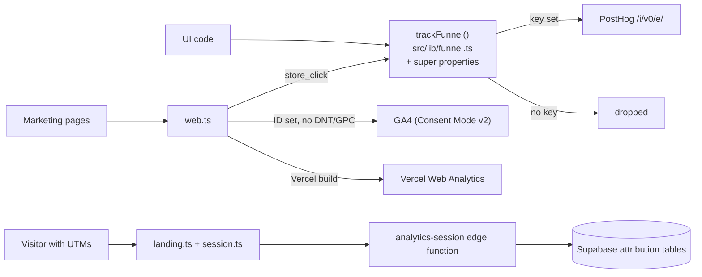

# Tandava Analytics

Tandava measures three things, each optional and off until an operator sets its switch:

| Layer | What it answers | Where it runs | Switch (empty = off) |
|---|---|---|---|
| Product analytics | Who opens, books, checks in, buys; cohorts, retention, A/B tests | Booking app, studio dashboard, native apps | `VITE_POSTHOG_KEY` |
| Vercel Web Analytics | Visits to public pages, cookie-free | Marketing pages, Discover, studio pages | on for Vercel builds; `VITE_VERCEL_ANALYTICS=false` turns it off |
| Google Analytics 4 | Which marketing pages and links bring studios in | Public marketing pages only | `VITE_GA4_MEASUREMENT_ID` |

Plus first-party attribution (channel, landing, session) stored in Supabase, and Sentry for errors. Analytics must never break the booking path: every call is wrapped, and with no switch set nothing is sent anywhere. A self-hosted install that sets none of these sends nothing to any analytics provider.

All switches live in `src/config/analytics.ts`, which the code and the privacy page both read, so `/privacy` names exactly the providers that are on.

## Product analytics: one facade, no SDK

`src/lib/funnel.ts` is the one `track` facade (`trackFunnel`). It posts to an optional sink: `src/lib/funnelSink.ts` sends to PostHog's capture endpoint over plain `fetch` (no vendor SDK, `keepalive`, errors swallowed). Host defaults to PostHog Cloud US (`VITE_POSTHOG_HOST` for EU or self-hosted). `src/main.tsx` installs the sink at startup.

Events carry an anonymous visitor id (`tandava.vid`, a random id in localStorage, `src/lib/analytics/session.ts`) and never names, emails or free text. No advertising id, no ATT prompt, no cross-app tracking, no session replay in PostHog.

### Events

The original six funnel names are unchanged. The rest follow the shared portfolio taxonomy (snake_case, same names in every Purafield app).

| Event | When | Props | Emitted by |
|---|---|---|---|
| `app_opened` | every cold start (page load or app launch) | `first_open` | `src/main.tsx` |
| `discover_viewed` | Discover opened | | `Discover.tsx` |
| `discover_filtered` | filter or search on Discover | `kind`, `value` | `Discover.tsx` |
| `class_opened` | class detail opened from Discover | `studio`, `occurrence` | `Discover.tsx` |
| `checkout_started` | Stripe checkout started | `kind` (`membership`, `class_pack`, `drop_in`) | `PurchaseButton`, `BookClassButton` |
| `purchase_started` | same moment, shared name | `product_id` (the product kind) | derived in the facade from `checkout_started` |
| `booking_completed` | booking confirmed or waitlisted | `source`, `status` | `BookClassButton` |
| `key_action` | each confirmed booking or check-in | `action` (`booking`, `checkin`) | facade; `TeachingClasses` |
| `activation_reached` | first confirmed booking (student), first confirmed check-in (studio), once per browser | `action` (`first_booking`, `first_checkin`) | facade |
| `store_click` | click on an App Store or Google Play link | `store`, `app`, `placement` | `src/lib/analytics/web.ts` |
| `first_attended` | defined, not emitted (see gaps) | | |

`purchase_completed`, renewals and refunds come from the server (Stripe webhooks today; RevenueCat if in-app purchases ship), not from the client.

### Super properties

Every event carries:

| Property | Value |
|---|---|
| `app` | `tandava` on the web; `tandava_member` or `tandava_studio` in the native builds (`VITE_NATIVE_APP`) |
| `app_version` | `package.json` version, baked in at build (`VITE_APP_VERSION`) |
| `platform` | `web`, `ios` or `android` (Capacitor) |
| `schema_version` | `1`; bump when an event's meaning changes |
| `install_source` | the first visit's `utm_source`, else its channel (`organic_search`, `direct`...) from `channel.ts` |
| `install_campaign` | the first visit's `utm_campaign` |

`install_source` / `install_campaign` are the first-party first touch, kept once in localStorage (`tandava.first_touch`) and never overwritten. Inside the native apps the web view has no landing URL, so they stay empty: iOS campaign installs are read per campaign in App Store Connect, and Android can read the Play Install Referrer once the Studio app is on Play.

Retention (D1, D7, D30) comes from `app_opened` cohorts in PostHog; cohorts, funnels, feature flags and Experiments use the same events.

### Gaps (known, deliberate)

- `first_attended`: attendance is recorded on the staff or teacher device, which does not know whether it is the member's first class. The clean source is the server: the first `checked_in` booking per profile. Add it as a server-side capture (edge function or webhook to PostHog) rather than a client guess.
- `paywall_viewed`: Tandava has no paywall screen. Members see prices on studio pages and go straight to Stripe Checkout, so `purchase_started` is the first purchase signal.
- Express guest bookings (`ExpressBooking`) do not emit `booking_completed` yet.
- The Studio app's QR scan check-in (in review on a separate branch) should call `trackCheckin()` after the server confirms, like `TeachingClasses` does.
- PostHog `identify` is not wired; the anonymous visitor id is joined to the account first-party (`profile_visitors`). If identify is added, use the internal profile id only.

## Website analytics: Vercel Web Analytics and GA4

`src/lib/analytics/web.ts`, started from `src/main.tsx`. Neither runs inside the native apps.

- **Vercel Web Analytics** loads `/_vercel/insights/script.js` (first-party, no cookies). A `beforeSend` hook drops every signed-in page (`/manage`, `/teach`, `/staff`, `/account`, `/admin`, `/auth`...) and strips query strings down to campaign tags. It counts marketing pages, Discover and studio pages.
- **GA4** loads only when `VITE_GA4_MEASUREMENT_ID` is set, and only once the visitor is on a marketing page: `/` (platform landing), `/for-studios`, `/studio-app`, `/yoga-studio-software`, `/class-booking-software`, `/blog/*`, `/tools/*`, `/open-source`, `/support`, `/terms`, `/privacy`, `/refunds`. On any other route Google's own `ga-disable-<ID>` flag is set, so a visitor who moves into the booking app or dashboard sends nothing more. `/` counts only when it shows the platform landing (not on a studio subdomain or with `VITE_HOME_MODE=discover`). Page views are sent manually with the URL reduced to path plus campaign tags. Google signals and ad personalization are off.
- **Do Not Track and Global Privacy Control**: GA4 does not load.
- **Consent Mode v2**: default `analytics_storage`, `ad_storage`, `ad_user_data`, `ad_personalization` denied in the EEA, UK and Switzerland (`CONSENT_REGIONS`); elsewhere analytics granted, ads always denied. A small Allow / No thanks notice shows only when the browser time zone starts with `Europe/`; the choice is kept in `tandava.analytics_consent`.
- **Self-exclusion**: `?notrack=1` on any page turns website and product analytics off in that browser; `?track=1` turns them back on. `/privacy` has the same switch for visitors.
- **Events** (GA4 and Vercel): `store_click` (`store`, `app`, `placement`, `page_path`), `outbound_click` (`host`), `contact_click` (`method`). `placement` comes from a `data-placement` attribute or the page region (`header`, `menu`, `footer`, `body`).

The site's CSP already allows this (`script-src 'self' https:`, `connect-src https:`); no inline script is used.

## Store links carry the source

`src/lib/analytics/storeLinks.ts`:

- App Store: `https://apps.apple.com/app/id<APP_ID>?pt=<PROVIDER_TOKEN>&ct=<campaign>&mt=8`. `pt` comes from `VITE_APP_STORE_PROVIDER_TOKEN`; with no token the link is plain (`mt=8` only), since Apple ignores `ct` without `pt`. Results show in App Store Connect > App Analytics > Acquisition > Campaigns.
- Google Play: `https://play.google.com/store/apps/details?id=<PKG>&referrer=utm_source%3D...%26utm_medium%3D...%26utm_campaign%3D...`, package from `VITE_PLAY_STUDIO_PACKAGE` (empty until the Studio app has a Play listing).
- Campaign values follow the shared vocabulary (PRD-024, app-launch-playbook UTM-CONVENTIONS.md): lowercase with underscores, `ct` at most 40 characters, `utm_medium=organic_social` for unpaid posts. `StudioAppBadge` passes the visitor's original `utm_campaign` when there is one, else `tandava_site_<placement>` (default placement `app_badge`), so the store sees the first source. The JSON-LD and prerendered fallback keep the plain canonical link.

## Privacy

`src/content/legal/analytics.ts` writes the privacy page's "Website and product analytics" section and the analytics part of "Service providers" from the same switches. Turning a provider on or off changes the policy in the same build.

### App Store privacy labels (when `VITE_POSTHOG_KEY` is set in the native build)

Keep the entries the apps already declare (contact info, purchases, user id for accounts, Sentry diagnostics if on). Add for analytics, the same for Tandava (member app) and Tandava Studio (owner app):

- Data Used to Track You: **No**. No data is used for tracking.
- Identifiers > Device ID: **Collected**, Linked to you: **Yes**, Tracking: **No**, Purposes: **Analytics**. (A random id kept on the device, joined to the account first-party.)
- Usage Data > Product Interaction: **Collected**, Linked to you: **Yes**, Tracking: **No**, Purposes: **Analytics**, **App Functionality**.

If the native build has no PostHog key, add nothing for analytics.

### Google Play Data safety (Studio app on Play, same condition)

- App activity > App interactions: Collected, not shared, Analytics, processed ephemerally: No, required.
- Device or other IDs: Collected, not shared, Analytics.
- Data is encrypted in transit: Yes. Users can request deletion: Yes.

PostHog acts as a service provider (processor), so this is "collected, not shared".

## Turning it on (hosted service)

1. PostHog: one project per app (Cloud US). Set `VITE_POSTHOG_KEY` in Vercel (Production and Preview) and in the native build environment, redeploy, then check Live events for `app_opened` with the super properties.
2. Vercel Web Analytics: Vercel > project > Analytics > Enable. The code side is already on for Vercel builds.
3. GA4: create a web property and stream for the marketing domain, turn off Enhanced measurement "Page changes based on browser history events" and "Outbound clicks" (the code sends its own), set `VITE_GA4_MEASUREMENT_ID` in Vercel, redeploy. Then in GA4 Admin: mark `store_click` as a key event; add event-scoped custom dimensions `app`, `store`, `placement`, `host`; set data retention to 14 months; link Search Console.
4. App Store campaign links: copy the provider token from App Store Connect into `VITE_APP_STORE_PROVIDER_TOKEN`.
5. Visit the site once with `?notrack=1` on each of your own devices.

## Attribution infrastructure

Separate from the funnel, Tandava has first-party attribution for marketing source tracking:

| Piece | File | Role |
|---|---|---|
| Channel classifier | `src/lib/analytics/channel.ts` | Classifies the traffic channel (TeacherTree appears here only as a link-in-bio referrer domain) |
| Landing capture | `src/lib/analytics/landing.ts` | Captures landing page context |
| Session tracking | `src/lib/analytics/session.ts` | Client session handling |
| Sources | `src/lib/analytics/sources.ts` | Source definitions |
| Edge function | `supabase/functions/analytics-session` | Server-side session endpoint with a per-source rate limit (salted IP hash kept at most a day; salt via `ANALYTICS_IP_SALT` Supabase secret, falling back to `EXPRESS_IP_SALT`) |
| Owner UI | `/manage/analytics/sources`, `/manage/utm-builder` | Attribution sources dashboard and UTM builder for studio owners |

Specs: `docs/prd/ATTRIBUTION_TRACKING.md` and PRD-024, which applies the same pattern and UTM vocabulary across Purafield's sites and store listings.

## Sentry (optional)

`VITE_SENTRY_DSN` enables Sentry error monitoring (`src/lib/sentry.ts`). It is error tracking, not product analytics, and is independent of the funnel sink.
