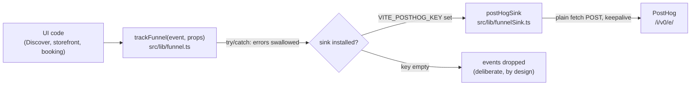
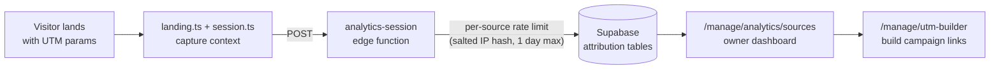

# Tandava Analytics

Tandava's product analytics is a small, deliberate system: six funnel events defined in code, posted to an optional PostHog sink over plain `fetch` with no vendor SDK, plus first-party attribution infrastructure (channel, landing, session) backed by an edge function. Analytics must never break the booking path, so everything degrades silently and events are dropped when no sink is configured.

Last verified: 2026-10-20 (against repo HEAD `d694b2ba6`).

## The funnel: six events

`src/lib/funnel.ts` defines the event vocabulary. Names are fixed in code so dashboards and tests agree. (One-line meanings below follow the acquisition-to-activation order; the props each event carries were not verified in this pass, [VERIFY].)

| Event | Meaning in the funnel |
|---|---|
| `discover_viewed` | A visitor viewed the Discover marketplace |
| `discover_filtered` | A visitor applied a filter on Discover (style, teacher, time, etc.) |
| `class_opened` | A visitor opened a class detail (storefront or schedule) |
| `checkout_started` | A visitor began checkout for a booking |
| `booking_completed` | A booking was completed (including express guest booking) |
| `first_attended` | A member attended their first class (activation) |

Events are emitted with `trackFunnel(event, props)`, which calls the installed sink inside a try/catch: on any error it does nothing. The header comment is explicit: "Analytics must never break the booking path."

## The sink: plain fetch, no SDK, optional

`src/lib/funnelSink.ts` implements the sink:

- `postHogSink({ key, host, distinctId })` POSTs JSON to `{host}/i/v0/e/` with `api_key`, `event`, `distinct_id`, `properties` (funnel props plus `$current_url`), and a timestamp. It uses `keepalive: true` and swallows network errors.
- `funnelSinkFromEnv(env, distinctId)` returns the sink when `VITE_POSTHOG_KEY` is set (trimmed), or `null` when it is empty. Host defaults to `https://us.i.posthog.com` (`https://eu.i.posthog.com` for EU, or a self-hosted host).
- Events carry an anonymous visitor id only. The file header states they never carry names or emails.

Design notes from the file headers (verbatim ideas, not quotes): there is deliberately no vendor SDK; the sink is operator-configurable (PostHog, Plausible, a Supabase insert); with no sink, events are dropped. `.env.example` documents the contract:

```
# Student funnel events (discover_viewed ... booking_completed) to PostHog, no SDK.
# Leave empty to drop them. Host defaults to https://us.i.posthog.com (use https://eu.i.posthog.com for EU).
VITE_POSTHOG_KEY=
# VITE_POSTHOG_HOST=
```

Wiring: `src/main.tsx` installs the sink at startup (`setFunnelSink(funnelSinkFromEnv(...))`), verified present in the current file. The plumbing landed in commit `cda141e7` (2026-10-09, PR #94).



## Open item: the PostHog project does not exist yet

The code has been in place since 2026-10-09, but `.env.example` ships `VITE_POSTHOG_KEY=` empty, and `funnelSinkFromEnv` returns `null` without a key, so **no funnel events are being collected anywhere today**. This is a known open launch item (tracked in the repo's progress notes).

Steps to close (no key is exposed here, and none should be committed):

1. Create the PostHog project (US cloud default; EU cloud if the studio base is in the EU).
2. Add the project API key to the hosting environment as `VITE_POSTHOG_KEY` (e.g. Vercel env for the deployed app; `.env.local` for local verification). Never commit the key.
3. Rebuild/redeploy so the build-time `VITE_` variable is baked in.
4. Walk the funnel once (Discover view, filter, class open, checkout, booking, first check-in) and confirm all six events arrive in the PostHog project.
5. Mark the open item closed in the launch tracker.

## Sentry (optional)

`VITE_SENTRY_DSN` enables Sentry error monitoring (`@sentry/react` in `package.json`, `src/lib/sentry.ts`). Optional; the app runs without it. It is error tracking, not product analytics, and is independent of the funnel sink.

## Attribution infrastructure

Separate from the funnel, Tandava has first-party attribution for marketing source tracking:

| Piece | File | Role |
|---|---|---|
| Channel classifier | `src/lib/analytics/channel.ts` | Classifies the traffic channel (note: TeacherTree appears here only as a link-in-bio referrer domain, not a repo relationship) |
| Landing capture | `src/lib/analytics/landing.ts` | Captures landing page context |
| Session tracking | `src/lib/analytics/session.ts` | Client session handling |
| Sources | `src/lib/analytics/sources.ts` | Source definitions |
| Edge function | `supabase/functions/analytics-session` | Server-side session endpoint with a per-source rate limit (salted IP hash kept at most a day; salt via `ANALYTICS_IP_SALT` Supabase secret, falling back to `EXPRESS_IP_SALT`) |
| Owner UI | `/manage/analytics/sources`, `/manage/utm-builder` | Attribution sources dashboard and UTM builder for studio owners |

Specs: `docs/prd/ATTRIBUTION_TRACKING.md`; PRD-024 prescribes the same attribution pattern and UTM vocabulary across purafieldstudio.com, cuecraftyoga.com, rationalyoga.com, and the CueCraft and WakeState listings (the concrete cross-property link in the portfolio).



[VERIFY: the exact attribution table names and the full event/property schema were not read in this pass; see `docs/prd/ATTRIBUTION_TRACKING.md` and migration `00024_attribution_marketing_foundation.sql` / `00035_attribution_phase1.sql`.]
