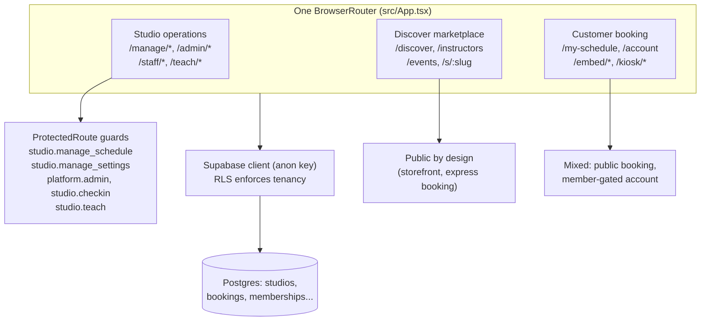
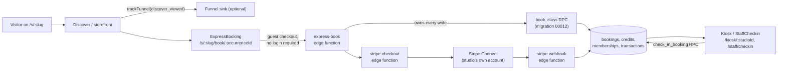
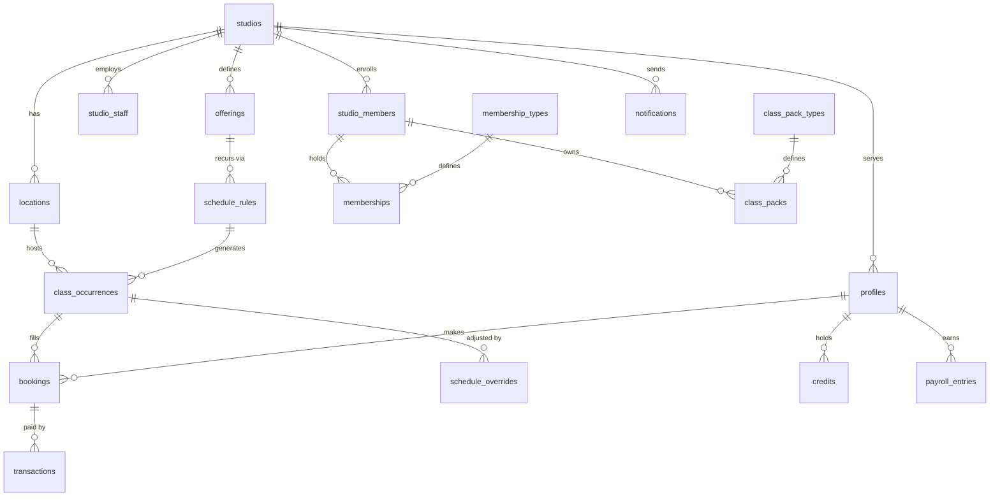

# Tandava Architecture: System Map

What Tandava is built from and how the pieces connect: one static SPA with three route groups, one Supabase Postgres database with RLS multi-tenancy, Stripe Connect for payments, and a set of edge functions. This is the entry point. For depth, the `docs/developer/` guides carry ~37 mermaid diagrams (`01-domain-model.md`, `02-architecture.md`, `03-key-flows.md`, `04-integrations.md`, `05-scenarios.md`, `07-launch-architecture.md`). For decisions and trade-offs (what is intentional, what is replaceable), see the root [`ARCHITECTURE.md`](../ARCHITECTURE.md). For agent working rules, see `docs/ai-agents/AGENTS.md`.

Last verified: 2026-10-20 (against repo HEAD `d694b2ba6`).

## System components

| Component | What it is | Key files |
|---|---|---|
| Web app | React 18 + TypeScript + Vite 7 static SPA; no server runtime in production | `src/App.tsx`, `src/main.tsx` |
| UI | shadcn/ui (Radix primitives) + Tailwind CSS 3 | `src/components/`, `src/styles/` |
| Routing | react-router-dom ^7.18.3, one `BrowserRouter` in `src/App.tsx` | `src/App.tsx` |
| Data fetching | TanStack Query | hooks under `src/hooks/` |
| Backend abstraction | Provider interface; app code never imports Supabase directly | `src/lib/backend/` |
| Database | Supabase Postgres, one shared database, RLS multi-tenancy | `supabase/migrations/` (44 files, `00001`..`00044`) |
| Auth | Supabase Auth (JWT + sessions); mock auth when `VITE_DEMO_MODE=true` | `src/contexts/AuthContext.tsx` |
| Edge functions | Deno functions for webhooks, email, SMS, push, express booking | `supabase/functions/` (15 functions + `_shared`) |
| Payments | Stripe Connect (Standard): each studio connects its own Stripe account | `supabase/functions/stripe-*`, `src/lib/stripe.ts` |
| Storage | Supabase Storage (file uploads) | [VERIFY: bucket names not confirmed in this pass] |
| Hosting | Any static host; `vercel.json` for the reference deploy | `vercel.json` |
| Analytics sink | Plain-fetch PostHog capture, no SDK; off until `VITE_POSTHOG_KEY` is set | `src/lib/funnel.ts`, `src/lib/funnelSink.ts`, `src/main.tsx` |
| Error monitoring | Sentry, optional | `VITE_SENTRY_DSN`, `src/lib/sentry.ts` |

## Three surfaces, one app: the route map

This is the key structural fact. The "open-source app / discovery app / customer app" framing you may hear describes **route groups in one SPA**, not three apps. Evidence: one `package.json`, one `src/App.tsx` `BrowserRouter`, one Supabase database, and 44 migrations. There is no inter-app sync because there is nothing to sync.

| Surface | Routes (from `src/App.tsx`) | Key pages | Guards |
|---|---|---|---|
| Studio operations | `/manage`, `/manage/schedule`, `/manage/students`, `/manage/teachers`, `/manage/offerings`, `/manage/financials`, `/manage/reports`, `/manage/import`, `/manage/settings`, `/manage/onboarding`, `/manage/members/:id`, `/manage/promo-codes`, `/manage/events`, `/manage/landing-pages`, `/manage/analytics` (+ `/members`, `/sales`, `/financials`, `/site`, `/sources`), `/manage/automations`, `/manage/connectors`, `/manage/products`, `/manage/inventory`, `/manage/purchase-orders`, `/manage/notification-settings`, `/manage/sms-inbox`, `/manage/utm-builder`, `/manage/campaigns`, `/manage/tasks`, `/manage/on-demand`, `/manage/feature-settings`, `/manage/audit-logs`, `/manage/data-dictionary`, `/manage/definitions`, `/manage/embed`, `/manage/share`; `/admin`, `/admin/studios`, `/admin/users`, `/admin/billing`, `/admin/feedback`, `/admin/settings`; `/staff/checkin`, `/staff/waitlist`; `/teach`, `/teach/schedule`, `/teach/availability`, `/teach/subs`, `/teach/earnings`, `/teach/profile` | `src/pages/manage/` (45 pages), `src/pages/admin/*`, `StaffCheckin`, `StaffWaitlist`, `src/pages/teach/*` | `studio.manage_schedule` (owner + admin day-to-day), `studio.manage_settings` (owner only), `platform.admin`, `studio.checkin`, `studio.manage_waitlist`, `studio.teach` |
| Discover marketplace | `/discover`, `/instructors`, `/instructors/:id`, `/events`, `/events/:id`, `/s/:slug`, `/on-demand`, `/schedule`; `/` shows the platform landing or the Discover experience per `VITE_HOME_MODE` | `Discover.tsx`, `Instructors.tsx`, `InstructorDetail.tsx`, `StudioStorefront.tsx`, `StudioDetail.tsx`, `OnDemand.tsx`, `Schedule.tsx` | Public; storefront gated on `studios.discoverable` |
| Customer booking | `/my-schedule`, `/account`, `/account/notifications`, `/community`, `/home`; `/s/:slug/book/:occurrenceId`, `/s/:slug/save-details`; `/embed/schedule/:slug`, `/embed/event/:id`; `/kiosk/:studioId` | `MySchedule.tsx`, `Account.tsx`, `src/pages/account/*`, `ExpressBooking.tsx` (login-free guest booking, PRD-020), `Kiosk.tsx`, `src/pages/embed/*` | `member.view_profile` for account pages; booking routes public by design |

External touchpoints that cross the SPA boundary: the embeddable widget (`public/embed.js`, `public/widget.js`, `<tandava-schedule>`; see `docs/guides/website-embed.md`), per-studio subdomains via `VITE_ROOT_DOMAIN` (e.g. `oxatl.tandavastudio.com`, wildcard DNS; see `docs/OPERATOR_SETUP.md`), and storefront deep links (`/s/<slug>`, `/s/<slug>/book/<occurrenceId>`) that double as the planned native apps' universal links.

## Data flow: the booking path

The critical path (see `docs/architecture/RELIABILITY.md`: booking, check-in, payments, and auth must never fail):

Notes:
- Express Booking (PRD-020) is deliberately public: the `express-book` edge function owns every write, and a guest can book a drop-in with name and email, no password. The account step comes after (the `/s/:slug/save-details` flow and `/auth/reset-confirm?claim=1` claim link).
- Seat holds (`00033_seat_holds.sql`) and booking-integrity checks (`00030_booking_integrity.sql`, `00031_payments_integrity.sql`) guard the write path.
- Analytics never touches this path: `trackFunnel` swallows errors by design ("Analytics must never break the booking path", `src/lib/funnel.ts`).

## RLS multi-tenancy (summary)

- Every tenant-scoped table carries `studio_id`; RLS policies are the security boundary, not application checks (see `docs/architecture/MULTI_TENANCY.md` and `docs/architecture/ROLE_ACCESS_CONTROL.md`).
- Platform admins (`/admin/*`, `platform.admin`) and studio roles (owner, admin, teacher, front desk, member) are enforced both at the route level (`ProtectedRoute` permissions in `src/App.tsx`) and at the database level (RLS).
- Service-role keys must never appear in client code; cross-studio access belongs in edge functions with explicit authorization (root `ARCHITECTURE.md`).
- RLS hardening has its own migrations: `00026_rls_recursion_and_gaps.sql`, `00028_security_baseline.sql`, `00029_policies_for_locked_tables.sql`, `00041_function_hardening.sql`.

## Edge functions

`supabase/functions/` holds 15 functions plus `_shared` (verified directory listing):

| Function | Role (from name and repo docs) |
|---|---|
| `stripe-checkout` | Creates Stripe Checkout sessions (drop-in, memberships, class packs) |
| `stripe-webhook` | Handles Stripe webhook events; records payments |
| `stripe-connect` | Studio Stripe Connect (Standard) OAuth onboarding |
| `stripe-portal` | Customer billing portal sessions |
| `express-book` | Owns every write for login-free express booking (PRD-020) |
| `cancel-class` | Studio-initiated class cancellation |
| `email` | Provider abstraction: Resend / SendGrid / SMTP / console (`EMAIL_PROVIDER`) |
| `sms` | SMS via Twilio or console (`SMS_PROVIDER`) |
| `push` | Web push (VAPID keys) |
| `onboarding` | Studio setup wizard backend |
| `run-automations` | Scheduled automations (see `/manage/automations`) |
| `import-members` | Final member import persistence (service role) |
| `analytics-session` | First-party attribution session tracking, per-source rate limit (`ANALYTICS_IP_SALT`) |
| `unsubscribe` | Email unsubscribe handling |
| `_shared` | Shared Deno helpers, not a function |

Typechecked with `npm run check:edge` (`deno check`); deployed to Supabase. [VERIFY: individual function internals were not read in this pass; roles above follow names and `.env.example`.]

## RPCs

Booking and read paths that need transactional or cross-table logic live in Postgres functions (migration filenames verified):

| RPC | Migration | Purpose |
|---|---|---|
| `book_class` | `00012_book_class_rpc.sql` (+ `00027_book_class_fixes.sql`) | Transactional class booking |
| `cancel_booking` | `00013_cancel_booking_rpc.sql` | Booking cancellation |
| `book_class_auto` | `00032_book_class_auto.sql` | Booking with automatic entitlement selection (membership/pack) |
| `check_in_booking` | (per repo research; exact migration [VERIFY]) | Class check-in |
| `discover_classes` | `00025_discover_classes.sql` | Discover marketplace class search |
| `get_my_bookings` | `00039_get_my_bookings.sql` | Member's bookings |
| `get_my_entitlements` | `00040_get_my_entitlements.sql` | Member's memberships/packs |
| `generate_class_occurrences` | `00036_generate_class_occurrences.sql` | Materializes `schedule_rules` into `class_occurrences` |

## Schema overview

One shared Postgres database for all three surfaces. Migration `00001_initial_schema.sql` creates 21 tables:

`studios`, `locations`, `profiles`, `studio_staff`, `studio_members`, `offerings`, `schedule_rules`, `class_occurrences`, `schedule_overrides`, `bookings`, `membership_types`, `memberships`, `class_pack_types`, `class_packs`, `transactions`, `credits`, `payment_methods`, `payroll_entries`, `notifications`, `import_jobs`, `import_field_mappings`.

Later migrations (`00002`..`00044`, filenames verified) add: workshops/events, analytics, connectors, staff/retail, check-in, campaigns, on-demand, audit, the instructor role, event deposits, push subscriptions, public schedule read, storefront, express booking, calendar occurrence facts, attribution, seat holds, owner catalog edits, teacher attendance, and RLS hardening.

For the full domain model with mermaid diagrams, see `docs/developer/01-domain-model.md`. For the class-style taxonomy (class styles, not poses; Tandava has no pose library), see `docs/data/CLASS_TYPES_TAXONOMY.md`.

## Demo mode

`VITE_DEMO_MODE=true` loads mock data from `src/data/demo/` (the fictional Oxatl Yoga studio: 3 locations, 18 teachers, 500 members) and bypasses all backend calls. Demo and production code never mix at runtime. The live demo at tandava-flame.vercel.app runs in this mode. See `docs/architecture/DEMO_SEPARATION.md`.

## Planned native apps

`docs/app-store/STORE-APPS.md`: "two apps, one backend". **Tandava** for members (`com.tandava.app`) and **Tandava Studio** for owners and staff (`com.tandava.studio`). Status: **decided Oct 8, 2026; nothing built yet**; bundle IDs registered with Apple; no native code in this repo. Recommended shell: Capacitor (same as the sibling Purafield apps). Storefront deep links (`/s/<slug>`, `/s/<slug>/book/<occurrenceId>`) are the future universal links; no new URL shape is planned.
