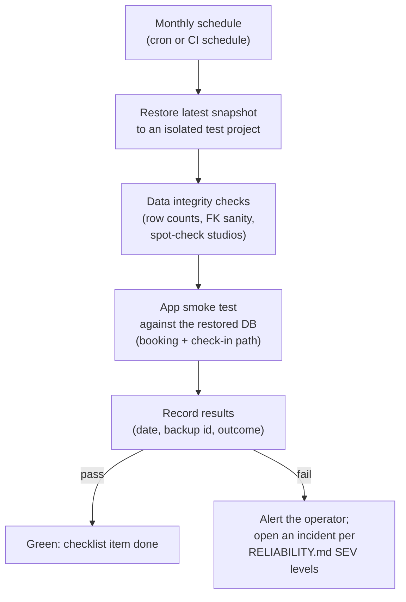

# Tandava Backup and Recovery

Tandava's data (studios, members, bookings, memberships, transactions) lives in one Supabase Postgres database. The backup strategy is documented in `docs/architecture/RELIABILITY.md` as three tiers. This doc restates that strategy concisely, names the gap honestly (the strategy relies on Supabase platform features with no in-repo verification), and sketches what would close it.

Last verified: 2026-10-20 (against repo HEAD `d694b2ba6`).

## What this is

The backup story for the production database behind Tandava. It covers the Supabase Postgres that holds every studio's operational data. It does not cover the static frontend (rebuildable from git) or the demo mock data (`src/data/demo/`).

## Strategy versus verified coverage

`docs/architecture/RELIABILITY.md` describes replication, point-in-time recovery and
long-term archives as targets. Their RPO/RTO figures are design targets, not measured
recovery guarantees. Replication is not a substitute for an independent backup.
This documentation review did not inspect the hosted plan, retained backups or a
restore receipt. The three workflows in this source revision do not include a
scheduled backup. That does not establish what the provider performs outside GitHub.

## Supported recovery entry points

Follow the current [Supabase backup guide](https://supabase.com/docs/guides/platform/backups)
(checked October 20, 2026). Daily backups and PITR are different capabilities;
availability and retention depend on the project's configuration. In the Dashboard,
open **Database → Backups**, inspect available recovery points, and use the applicable
daily-backup or point-in-time restore flow. Restoring makes the project inaccessible
while recovery runs and rolls data back to the selected point. The Management API is
also documented by Supabase; the old `supabase db restore` and `supabase db backups`
examples in the architecture strategy are not executable instructions for this runbook.

Before a production restore, confirm the project, approved recovery point and expected
data loss; preserve available current evidence and obtain incident-owner authorization.
Rehearse on an isolated destination using the provider's supported recovery workflow.
Record backup identity, source time, destination, duration, integrity checks and app
smoke results. For table-level recovery, recover into isolation and prepare a reviewed
reconciliation of rows and dependent records; do not pipe a table dump directly into
production as a generic repair.

Database backups exclude Storage API object contents. Inventory those objects and
establish their separate recovery procedure. Hosted backup settings, encrypted offsite
copies, alert delivery and successful restore evidence remain to be verified for Tandava.

## Proposed verification workflow (sketch)

To close the gap without overbuilding, wire the existing monthly checklist into something evidenced. Sketch only; not implemented:

Concrete options, cheapest first:

1. **Calendar-owned drill (no code):** put the monthly restore drill on the operator's calendar with a runbook (the procedures above), and record each run's date, backup id, and outcome in the repo or ops log. This satisfies the `RELIABILITY.md` checklist and the `AUDIT_COMPLIANCE.md` quarterly testing with the least machinery.
2. **Scheduled CI workflow:** a monthly GitHub Actions workflow that restores to a throwaway Supabase project, runs `scripts/db-test.sh`-style checks plus a booking smoke test, and posts the result. This is proposed work, not an existing or verified drill.
3. **Repo-owned `pg_dump` artifact:** a scheduled workflow that dumps the database and stores an encrypted copy outside Supabase (defense against platform-level failure). This is the Tier 3 "cold archive" made concrete and evidenced. Note it needs careful secret handling and is a separate operational change requiring an approved destination and retention policy.

## What to verify before relying on this doc

- [VERIFY] The production Supabase project's plan and which backup features (PITR window, snapshot retention) that plan actually includes.
- [VERIFY] That RLS policies and the migration set restore cleanly (the repo has DB migration tests on postgres:16 via `npm run test:db`; a restore drill should run these against the restored copy).
- [VERIFY] Storage buckets: backup/restore story for Supabase Storage objects (uploads) is not covered in `RELIABILITY.md`; confirm whether anything beyond the database needs a backup plan.

## Related docs

- `docs/architecture/RELIABILITY.md`: full strategy, SLA targets, incident response, performance budgets
- `docs/architecture/AUDIT_COMPLIANCE.md`: quarterly restore testing prescription
- `LAUNCH_RUNBOOK.md`: historical plan notes; verify current provider configuration
- `docs/architecture/ROLE_ACCESS_CONTROL.md`, `docs/architecture/MULTI_TENANCY.md`: why a restore must preserve RLS isolation between studios
