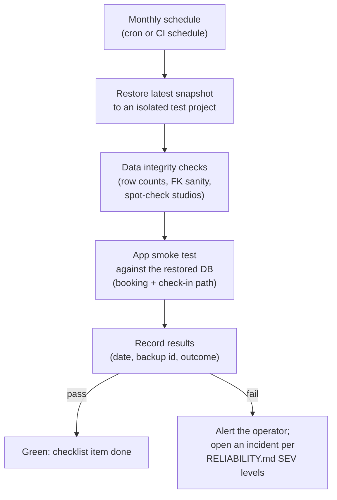

# Tandava Backup and Recovery

Tandava's data (studios, members, bookings, memberships, transactions) lives in one Supabase Postgres database. The backup strategy is documented in `docs/architecture/RELIABILITY.md` as three tiers. This doc restates that strategy concisely, names the gap honestly (the strategy relies on Supabase platform features with no in-repo verification), and sketches what would close it.

Last verified: 2026-10-20 (against repo HEAD `d694b2ba6`).

## What this is

The backup story for the production database behind Tandava. It covers the Supabase Postgres that holds every studio's operational data. It does not cover the static frontend (rebuildable from git) or the demo mock data (`src/data/demo/`).

## The tier strategy (from `docs/architecture/RELIABILITY.md`)

| Tier | Mechanism | RPO | RTO |
|---|---|---|---|
| Tier 1: real-time replication | Supabase streaming read replicas | ~0 seconds | < 5 minutes |
| Tier 2: point-in-time recovery | Automated daily snapshots | 24 hours | < 1 hour |
| Tier 3: long-term archive | Encrypted backups to cold storage | (weekly cadence) | (restore from archive) |

Tier 3 retention: 1 year. Target data durability in `RELIABILITY.md`: 99.999999999% annual.

## The gap

`.github/workflows/` contains exactly `ci.yml`, `platform-independence.yml`, and `stripe-smoke.yml`. There is **no scheduled backup workflow and no in-repo verification** that any tier is actually running. The strategy relies entirely on Supabase platform features:

- What Supabase provides: the tiers above are Supabase platform capabilities (replication, daily snapshots/PITR, and whatever archive the plan includes). [VERIFY: the actual Supabase plan of the production project was not confirmed in this pass. `LAUNCH_RUNBOOK.md` notes that Pro ($25/mo) adds backups, which implies the free tier's backup story is thinner. Confirm which plan the production project is on before relying on Tier 2/3.]
- What needs proving: that snapshots are taken, that a restore actually works, and that someone would notice if either stopped. Nothing in the repo proves any of this today.
- What exists on paper: `RELIABILITY.md` prescribes monthly backup verification (restore to a test environment, run integrity checks, verify app functionality, document results), and `AUDIT_COMPLIANCE.md` prescribes quarterly restore testing. Neither has evidenced runs in the repo.

## Restore procedures (from `docs/architecture/RELIABILITY.md`)

Point-in-time recovery:

```bash
# Preview first
supabase db restore \
  --target-time "2026-02-05T14:30:00Z" \
  --dry-run

# Execute
supabase db restore \
  --target-time "2026-02-05T14:30:00Z" \
  --confirm
```

Full restore from a backup:

```bash
supabase db backups list
supabase db restore --backup-id <id>
```

Table-level recovery (for a single-table incident, e.g. a bad migration touching `bookings`):

```bash
# 1. Create temp database from backup, 2. export the table, 3. import into production
pg_dump -t bookings backup_db > bookings_backup.sql
psql production_db < bookings_backup.sql
```

## Proposed verification workflow (sketch)

To close the gap without overbuilding, wire the existing monthly checklist into something evidenced. Sketch only; not implemented:



Concrete options, cheapest first:

1. **Calendar-owned drill (no code):** put the monthly restore drill on the operator's calendar with a runbook (the procedures above), and record each run's date, backup id, and outcome in the repo or ops log. This satisfies the `RELIABILITY.md` checklist and the `AUDIT_COMPLIANCE.md` quarterly testing with the least machinery.
2. **Scheduled CI workflow:** a monthly GitHub Actions workflow that restores to a throwaway Supabase project, runs `scripts/db-test.sh`-style checks plus a booking smoke test, and posts the result. Heavier; do this once the hosted service has paying studios.
3. **Repo-owned `pg_dump` artifact:** a scheduled workflow that dumps the database and stores an encrypted copy outside Supabase (defense against platform-level failure). This is the Tier 3 "cold archive" made concrete and evidenced. Note it needs careful secret handling and is only worth it for the hosted production database.

## What to verify before relying on this doc

- [VERIFY] The production Supabase project's plan and which backup features (PITR window, snapshot retention) that plan actually includes.
- [VERIFY] That RLS policies and the migration set restore cleanly (the repo has DB migration tests on postgres:16 via `npm run test:db`; a restore drill should run these against the restored copy).
- [VERIFY] Storage buckets: backup/restore story for Supabase Storage objects (uploads) is not covered in `RELIABILITY.md`; confirm whether anything beyond the database needs a backup plan.

## Related docs

- `docs/architecture/RELIABILITY.md`: full strategy, SLA targets, incident response, performance budgets
- `docs/architecture/AUDIT_COMPLIANCE.md`: quarterly restore testing prescription
- `LAUNCH_RUNBOOK.md`: plan notes (Pro $25/mo adds backups)
- `docs/architecture/ROLE_ACCESS_CONTROL.md`, `docs/architecture/MULTI_TENANCY.md`: why a restore must preserve RLS isolation between studios
