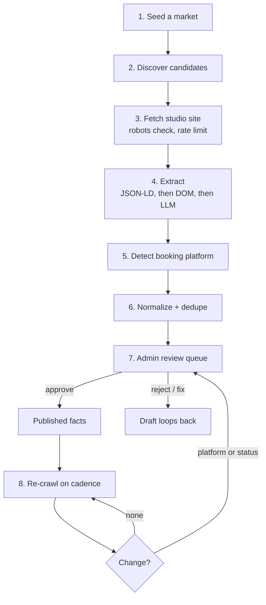

# Scraping and data collection plan: studio directory

Status: plan only. **No scraping has been run and none is authorized by this
document.** Written 2026-10-23. Owner: Taylor.
Part of [PRD-028](../prd/PRD-028-studio-directory.md). Shared rules live in
[SHARED-CORE.md](SHARED-CORE.md); this plan is the Tandava studio
implementation of them. TeacherTree runs the same stages for teachers under
its directory-v2 PRD.

---

## 1. Principles

1. **The studio's own public website is the source of truth.** Aggregators and
   map listings are for discovering that a studio exists, never for facts we
   publish when the studio's own site disagrees.
2. **Public pages only.** No logins, no paywalls, no form submissions, no
   CAPTCHA solving, no bypassing bot protection. If a site blocks the crawler,
   that studio is researched manually or not at all.
3. **We collect facts, not content.** Names, status, place, links, platform
   fingerprints. We do not copy bios, photos, schedules as content, or class
   descriptions. Summaries are written by us (see SHARED-CORE section 4.1).
4. **Every fact keeps its receipt.** Source URL, fetch date, evidence string.
   A fact without a receipt is deleted, not published.
5. **Polite by default.** Identify the crawler honestly in the user agent
   with a contact URL, respect robots.txt, crawl at a rate a small studio
   site would never notice, cache aggressively.

## 2. Pipeline

### Stage 1: Seed a market

A market is a city + radius with a named seed editor (a human, initially
Taylor or an operator he approves). Rollout order mirrors TeacherTree D3 so
the two datasets grow in the same places: **Austin first**, then Seattle,
then NYC / SF / LA. Bali and Koh Phangan come after their jurisdiction review
(SHARED-CORE gate 2), even though the data is easy to get.

### Stage 2: Discover candidates

Sources, in order of trust:

| Source | Used for | Terms gate |
|---|---|---|
| Curated seed list (hand-built per market) | The pilot's first 100 to 200 studios | None, human knowledge |
| OpenStreetMap (`leisure`/`sport=yoga`, studio tags) | Candidates + coordinates | ODbL attribution if rendered |
| Google Places API | Candidates, place ids, open/closed signals | API terms; Places data used per its policy, not bulk-stored beyond what the terms allow |
| Yoga / studio association listings | Candidates | Check each listing's terms before use |
| Studio's own site footer links ("also find us at") | Cross-discovery | Same as fetching their site |

Discovery output is a candidate row only: name, probable website, city. No
facts are published from discovery sources.

### Stage 3: Fetch

- Fetch list per studio: home page, schedule/classes page, booking page,
  contact/about page, footer links (Instagram, YouTube).
- robots.txt checked per domain and recorded in `directory_sources`.
- One fetch per page per crawl, conditional requests where supported, hard
  rate cap per domain (default: 1 req / 2s, max ~10 pages per studio per
  crawl), global crawl windows outside the studio's local peak hours.
- User agent identifies as the Tandava directory crawler with a URL explaining
  the directory and the correction/removal door. That page must exist before
  the first crawl.
- Blocked or 403: mark `fetch_blocked`, route to manual research. Never retry
  with spoofed agents.

### Stage 4: Extract

Order matters; stop at the first layer that answers:

1. **Structured data**: schema.org JSON-LD / microdata (`LocalBusiness`,
   `ExerciseGym`, opening hours, sameAs links). Highest trust.
2. **DOM heuristics**: link targets (booking domains from
   [BOOKING-PLATFORMS.md](BOOKING-PLATFORMS.md)), social links in header /
   footer, address blocks, status banners ("we've closed", "new location").
3. **LLM extraction** for what heuristics miss, constrained to the fetched
   text, returning value + verbatim evidence quote + confidence. No evidence
   quote, no fact.

Extracted per studio: name, status signals, city/area, address (internal),
phone (internal), business email (internal), website, Instagram, YouTube,
styles offered, locations count, platform candidates.

### Stage 5: Detect booking platform

Run the fingerprint library over the fetched pages (booking links, script
srcs, iframes, branded subdomains). Output feeds
`booking_platform_history` per SHARED-CORE section 4.5. A change versus the
last crawl opens the previous current row and starts a new one, and always
routes to human review before the public line changes.

### Stage 6: Normalize and dedupe

- Primary key: website domain. Secondary: Instagram handle. Tertiary fuzzy:
  name + city, which only ever creates a review task, never an auto-merge.
- Multi-location studios: one entity, locations counted; a location with its
  own name, site, and socials is its own entity. Reviewer decides edge cases.
- Chains/franchises: each location is an entity; the brand is a tag, not an
  entity, at v1.

### Stage 7: Review

Nothing publishes from the pipeline directly. The admin queue (pattern from
TeacherTree PR #79: draft / verified / published / suppressed, revision
conflicts, audit log) shows the entity with its facts, evidence, and the
source pages one click away. Reviewer actions: publish, edit (edit keeps the
original provenance and adds a manual source), reject, suppress.

### Stage 8: Re-crawl cadence

| Check | Cadence | Catches |
|---|---|---|
| Platform + status (booking page + home page only) | Monthly | Migrations, closures, reopening |
| Full fact refresh | Quarterly | New links, style changes, moves |
| Claimed entities | On claim, then claimed data rules apply | Scraped facts freeze; first-party data takes over the page |

Corroboration rule for status changes: a `permanently_closed` publish needs
two signals (examples: closure notice on site + booking page gone; or Places
listing marked permanently closed + social post). One signal puts the entity
back in the review queue as `unknown`, unpublished until resolved.

## 3. Volume and cost sketch (pilot)

Austin pilot: ~150 studios, ~8 pages each, monthly light re-crawl.
That is roughly 1,200 fetches for the seed crawl and ~300/month after. This
is a batch job measured in minutes, not infrastructure. Storage is the
extracted facts + hashes, not page archives; keep a 90-day rolling snapshot
of fetched HTML for evidence disputes, then drop it.

## 4. Legal and ethics checklist (before any real run)

- [ ] Source-terms review per source class in stage 2, written down
- [ ] Jurisdiction review for the launch market (US first; Bali/Koh Phangan
      wait for PDP/PDPA review, matching TeacherTree)
- [ ] Crawler info page live with correction / removal contact
- [ ] Removal and correction SLA adopted (TeacherTree directory-v2 model)
- [ ] No personal data in scope: business facts about studios only; teacher
      names appear only where the studio itself lists them publicly as its
      team, and teacher entities live in TeacherTree under its own rules
- [ ] Owner go-ahead for the specific pilot market and seed size

## 5. Failure modes we are designing against

| Failure | Mitigation |
|---|---|
| We publish a wrong platform | Human verification gate + 95% precision bar (BOOKING-PLATFORMS section 4) + correction door on every page |
| We list a closed studio as open | Monthly status check + corroboration rule, status shown with "last checked" |
| A studio does not want to be listed | Removal honoured, slug suppressed so crawls cannot resurrect it |
| Crawler annoys a small site | Rate caps, honest UA, caching, blocked means blocked |
| Two directories diverge (studio facts in TeacherTree vs Tandava) | Shared core spec + D4 one-way sync direction is already decided: TeacherTree studio facts sync to Tandava, not the reverse |
| This becomes a review site by drift | Page contract forbids ratings/reviews in code review checklist; adding any is a PRD change requiring owner approval |
