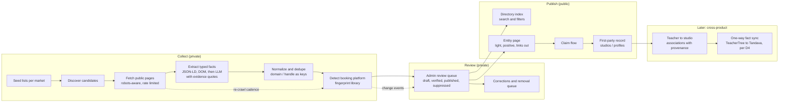

# Shared Directory Core: one directory engine, two entity types

Status: spec, not built. Written 2026-10-23. Owner: Taylor.
Canonical copy: this file in `TaylorONeal/tandava`. An identical copy lives in
`TaylorONeal/teachertree` at the same path. Any edit lands in both repos in the
same work session, or the copies have diverged and that is a bug.

Consumers:

| Product | Entity | Product PRD | Public surface (planned, gated) |
|---|---|---|---|
| Tandava | Studio | [PRD-028](https://github.com/TaylorONeal/tandava/blob/main/docs/prd/PRD-028-studio-directory.md) | `tandavastudio.com/studios`, `/studios/:slug` |
| TeacherTree | Teacher | [directory-v2](https://github.com/TaylorONeal/teachertree/blob/main/docs/prd/directory-v2.md) in teachertree, plus its v3 addendum | `teachertree.com/teachers`, detail merges into `/t/:handle` on claim |

---

## 1. Why this file exists

Tandava wants a public directory of yoga studios. TeacherTree is already
building a directory of yoga teachers (directory-v2 PRD, phases D1 to D4, and a
private sourced-draft foundation in TeacherTree PR #79). These are the same
machine with a different entity plugged in:

- discover entities from public sources
- extract a small set of typed, sourced facts
- hold everything private until a human reviews it
- publish a light, positive, factual page that links out
- let the entity claim the page, correct it, or have it removed
- re-check on a cadence and keep a history of what changed

Build that machine once, as a shared specification. Each product implements it
against its own database. There is no shared database and no shared service at
v1; what is shared is the schema shape, the taxonomy, the pipeline stages, the
review workflow, and the page contract, so the second implementation is a port,
not a redesign, and the two datasets can be joined later without a migration
crisis.

## 2. Architecture

## 3. The separation that makes this safe

Sourced directory records are **never** the first-party records.

| | Sourced (directory) | First-party (product) |
|---|---|---|
| Tandava | `directory_studios` | `studios` (migration 00001, has Stripe, members, bookings) |
| TeacherTree | sourced teacher drafts (PR #79 foundation) | `profiles`, `/t/:handle` pages |
| Written by | pipeline + admin review | the studio / teacher themselves |
| Trust level | "we observed this on their public site on this date" | "they told us this" |
| On claim | linked to the first-party record; first-party values win on the public page | unchanged |

Scraped data must never overwrite a claimed record, write into booking or
payment tables, or be used to contact anyone for marketing. It exists to render
a public factual page and an internal market map, nothing else.

## 4. Shared schema pattern

Each product creates the same table shapes with its entity name substituted.
Column names stay identical across products so queries, the review UI, and the
extraction code port with only the entity table swapped.

### 4.1 `directory_<entities>` (one row per sourced entity)

| Column | Notes |
|---|---|
| `id` uuid PK | |
| `slug` text unique | From name + city. Stable once published; changes go to `directory_suppressions` for the old slug |
| `display_name` text | As the entity presents itself publicly |
| `status` enum | `open`, `temporarily_closed`, `permanently_closed`, `historic`, `unknown`. See section 6 |
| `city`, `area` text | Public granularity. Street address is internal tier (section 5) |
| `country`, `region` text | Drives the privacy/jurisdiction gate for the market |
| `website_url` text | Canonical site. Primary dedupe key |
| `website_domain` text | Normalized domain, unique with city where needed |
| `summary` text | **Original** one or two sentences written by us. Never copied bio text |
| `review_state` enum | `draft`, `verified`, `published`, `suppressed` |
| `claimed_by` uuid null | First-party record id once claimed |
| `first_seen_at`, `last_verified_at` timestamptz | Shown publicly as "last checked" |
| `created_at`, `updated_at` | |

### 4.2 `directory_sources` (every observation, kept)

| Column | Notes |
|---|---|
| `id`, `entity_id` | |
| `source_type` enum | `website`, `booking_page`, `instagram`, `youtube`, `places_listing`, `manual` |
| `source_url` text | The exact page observed |
| `fetched_at` timestamptz | |
| `http_status` int | |
| `content_hash` text | Change detection between crawls |
| `robots_allowed` boolean, `terms_note` text | Recorded per source class; a source we may not use is not fetched |

### 4.3 `directory_facts` (typed facts with provenance)

One row per fact assertion, so a value is never separated from its evidence.

| Column | Notes |
|---|---|
| `entity_id`, `fact_key` text | e.g. `booking_platform.current`, `link.instagram`, `styles` |
| `value` jsonb | Typed value |
| `source_id` FK | Where it came from |
| `evidence` text | Short quote or fingerprint match that supports it |
| `confidence` numeric | Extractor or detector score |
| `observed_at` timestamptz | |
| `review_state` enum | Same states as the entity; a page publishes only facts at `verified` or better |

### 4.4 `directory_links`

`entity_id`, `kind` (`website`, `instagram`, `youtube`, `facebook`, `booking`,
`schedule`), `url`, `source_id`, `review_state`. The public page renders only
verified links of the public kinds. A link is a link out; we do not embed,
mirror, or republish their media at v1.

### 4.5 `booking_platforms` and `booking_platform_history`

The taxonomy table is **identical seed data in both products** (see
[BOOKING-PLATFORMS.md](https://github.com/TaylorONeal/tandava/blob/main/docs/directory/BOOKING-PLATFORMS.md) in Tandava; the seed list is normative for both products). History is a table, not a column, because "current plus
one previous" breaks the first time a studio has moved twice.

| `booking_platform_history` column | Notes |
|---|---|
| `entity_id`, `platform_id` | |
| `is_current` boolean | Exactly one current row per entity, or none when unknown |
| `observed_from`, `observed_to` timestamptz | **Observed** range, never presented as the true contract start/end |
| `detection_method` enum | `booking_link_domain`, `script_fingerprint`, `iframe`, `branded_subdomain`, `manual` |
| `confidence` numeric, `source_id` FK | Public display requires human verification regardless of score |

Public wording is neutral and dated: "Booking via Arketa. Previously:
Mindbody." No commentary on why they moved.

### 4.6 `directory_relationships` (later, gated)

Teacher to studio associations, in whichever product needs them first:
`teacher_entity_id`, `studio_entity_id`, `kind` (`teaches_at`, `owner`,
`founder`, `guest`), `source_id`, `observed_at`, `review_state`. An association
is an observed public fact ("listed on the studio's teachers page"), not an
identity merge. Cross-product joins match on stable keys (website domain,
Instagram handle, slug), never on name alone.

### 4.7 Review, corrections, audit, suppression

Both products reuse the model already built in TeacherTree PR #79:

- admin review queue with revision conflicts (an edit cannot silently
  overwrite a correction in flight)
- corrections / removal / rights requests recorded with resolution notes
- append-only audit log of state changes
- suppression list: a removed entity's slug and canonical keys stay suppressed
  so a later crawl cannot resurrect the page

Tandava implements the same four pieces for studios instead of forking a
second design.

## 5. Attribute tiers (what may be shown)

| Tier | Rule | Examples |
|---|---|---|
| **Public** | Rendered on the directory page | name, status, city + area, website, Instagram, YouTube, current + previous booking platforms, styles/categories, our original summary, last checked date |
| **Internal** | Collected, never rendered publicly | street address, phone, public business email, schedule snapshot, class counts, raw fingerprints, follower counts, price signals, lead notes |
| **Never** | Not collected, not shown | reviews, ratings, quality rankings, revenue estimates, personal (non-business) contact details, anything inferred about an individual's health, beliefs, or private life |

Two hard rules:

1. If a fact cannot be traced to a public source we are allowed to use, it
   does not exist for us.
2. Internal-tier data is for accuracy checking and the market map. It is not a
   sales call list. Outreach, where a phase calls for it, goes through the
   claim/correction door the page itself offers.

## 6. Status vocabulary (shared)

| Status | Meaning | Page treatment |
|---|---|---|
| `open` | Operating, current schedule or booking live | Full page, links out |
| `temporarily_closed` | Announced pause (renovation, seasonal, retreat break) with a stated or implied return | Page stays, status line shown, booking link kept |
| `permanently_closed` | Announced closure, or site and booking gone with corroboration | Page stays as a record, booking links removed, no "book" framing |
| `historic` | Closed, and notable (long-running, culturally significant, or heavily referenced) | Record page, "historic" label, founding/closing years when sourced |
| `unknown` | Cannot confirm either way | Never published. Internal only until resolved |

Status is a factual claim and needs the same provenance as any other fact. One
dead website is not a closure; the scraping plan defines the corroboration
rule.

## 7. Page contract (shared)

Every public entity page, both products:

- one entity per page, light: name, status, place, summary, links out,
  booking platform line, last checked date
- **positive or neutral only.** No reviews, no ratings, no comparisons, no
  editorializing about the entity or its platform choices
- a visible "Is this your studio / page? Claim it" door and a "Suggest a
  correction" door on every page, including unclaimed ones
- JSON-LD structured data matching what is visibly on the page
- indexable only when the entity is `published` and the market's jurisdiction
  gate has passed (section 8)

## 8. Gates that apply to both products

Nothing in either directory goes public until all of these hold for that
market:

1. Source-terms review: each source class we fetch from is one we are allowed
   to use this way.
2. Privacy/jurisdiction review for the market (TeacherTree already flags
   Indonesia PDP and Thailand PDPA for Bali and Koh Phangan; those markets
   wait for counsel review, US markets go first).
3. Correction and removal path live, with the SLA from TeacherTree
   directory-v2 (v1's claim workflow, reviewer roles, removal SLA, and audit
   model still apply there).
4. Owner approval for the specific market launch. Building the pipeline is not
   approval to publish, and a US pilot approval is not approval for any other
   market.

## 9. What differs by entity

| | Studio (Tandava) | Teacher (TeacherTree) |
|---|---|---|
| Signature sourced fact | **Booking platform, current + history** | Lineage, study threads, podcasts/media (directory-v2 "public signal") |
| Also sourced | styles, locations count | studios they teach at (relationships, section 4.6) |
| Claim converts to | Tandava lead, then hosted studio onboarding | TeacherTree profile claim, `/t/:handle` |
| Primary risk | Platform history stated wrong | Personal data about an individual stated wrong |
| Extra rule | Platform line is always dated and neutral | Interpretive copy (e.g. a teacher "signature" line) only after the teacher claims and approves it (directory-v2) |

## 10. Build order across both products

TeacherTree is ahead: directory-v2 PRD, D-phase plan, and the PR #79 private
foundation exist. Tandava ports that foundation's pattern for studios
(PRD-028) rather than inventing a parallel one. The shared pieces land in this
order:

1. This spec + the platform taxonomy (done as documents, 2026-10-23).
2. TeacherTree PR #79 foundation merged when its own gates allow (its call,
   not this spec's).
3. Tandava private studio foundation (SD1 in PRD-028 tasks): sourced drafts,
   review queue, platform history, no public pages.
4. First public launch in one US market per product, separately approved.
5. Relationships and cross-product sync (TeacherTree D4 already plans one-way
   studio fact sync to Tandava; this spec's section 4.6 is the join contract).
